# Tchat: Native Mobile Client

[](https://github.com/LibreChat-AI/LibreChat/releases/tag/v0.8.8)

The native Android/iOS client for **Tchat**, TensorGrid's self-hosted deployment of
[LibreChat](https://www.librechat.ai/) at `chat.tensorgrid.space`. There is no server field to
fill in — the app is pinned to Tchat and opens straight to sign-in.

This is a rebrand of [Switchboard](https://github.com/garfiec/Librechat-Mobile), a third-party
native LibreChat client, kept as a fork so it can keep pulling in Switchboard's fixes and
features. See [TCHAT.md](TCHAT.md) for exactly what this fork changes and why.

> **Backend compatibility:** Tested against LibreChat **v0.8.4 – v0.8.8**.

## Get it

<p align="center">
  <a href="https://apps.obtainium.imranr.dev/redirect?r=obtainium://add/https://github.com/garfiec/Librechat-Mobile"></a>
  <!-- Uncomment each badge once its listing is live.
  <a href="https://f-droid.org/packages/com.garfiec.librechat/"></a>
  <a href="https://play.google.com/store/apps/details?id=com.garfiec.librechat.play"></a>
  -->
  <a href="https://testflight.apple.com/join/pVhFr3a5"></a>
</p>

<p align="center"><sub>F-Droid and Google Play are coming soon. iOS is in public beta on TestFlight. See <a href="#install-android">Install (Android)</a> and <a href="#install-ios">Install (iOS)</a> for details.</sub></p>

## Why use this instead of the web app?

**It's a real app**

- **Smoother and faster** — a real native app instead of a website in a wrapper, so scrolling, typing, and watching responses stream in all feel snappier.
- **Feels like a mobile app, not a shrunk-down website** — swipe back and peek at where you're going before you let go, swipe to switch accounts, and a layout that spreads out on tablets and foldables.
- **Two looks, one app** — Material or Liquid Glass on Android or iPhone, any accent color with the whole app recoloring around it, or colors from your wallpaper. Light or dark, threads or two-sided bubbles.
- **From chat to home screen** — the apps and charts it builds run right in the chat. Pin one to your home screen and open it in a tap, even after the chat is gone. *(Android)*
- **Plays nicely with your phone** — share text, images, and files in from any app *(Android)*, launch your favorite models from the home screen, save or share images through your phone's normal menus, and dictate with your phone's own speech recognizer.
- **Works without a connection** — your chat list and any conversations you've opened are saved on your phone, so you can keep reading with spotty or no signal. Turn on background prefetch and recent chats are ready offline before you even open them.

**It's easier to use**

Same LibreChat, laid out for how you actually use it.

- **Everything where you'd look for it** — your model, its settings, tools, and attachments sit together right where you type, not in a sidebar of icons that change from chat to chat. Agents are in the same list as your models, and the agent editor only shows up when you ask for it.
- **One attach button for everything** — camera, photos, files on your phone, or files already on your server, without uploading them again.
- **Compare models** — pick any two, change either one at any time, and every message goes to both. Swipe between them on a phone, or read them side by side with synced scrolling on a tablet or foldable.
- **Find anything you've asked** — search every message in every chat, even offline, and land right on the one you meant. Or find text inside the chat you're reading.
- **All your media** — every image, file, and link from a chat in one place. Swipe through photos and drag one down to send it back.
- **Multiple accounts, one app** — sign in to different accounts on different LibreChat servers and switch between them instantly, no re-entering passwords.

## More features

- **Multi-Account** — Sign in to more than one Tchat account and switch between them instantly, no re-login. Swipe the account chip to switch; storage is fully scoped per account. All accounts are Tchat accounts — the server is fixed and there is no in-app way to point at a different one, in any build (see [TCHAT.md](TCHAT.md)).
- **Pin Artifacts to Home Screen** — Turn any generated artifact (HTML, React, SVG, Mermaid, Markdown) into a home-screen launcher icon that opens straight into a full-screen viewer — works on cold start, while logged out, and even after the source chat is deleted. *(Android)*
- **Quick Actions** — Your most-used models become home-screen shortcuts (Android) and long-press quick actions (iOS) that deep-link into a new chat with that model preselected.
- **Chat** — Real-time streaming (SSE), message branching & sibling navigation, stop/regenerate/continue, markdown with syntax highlighting, LaTeX math rendering, code blocks with copy, image display, file attachments, tool call progress cards
- **Answer Your Agents** — When an agent stops to ask you something or wants your OK before running a tool, answer right from the composer, one question at a time.
- **Inline Artifacts** — Render Mermaid, SVG, HTML, React, and Markdown artifacts directly in chat messages at full message width with content-fit height. Per-type toggle in Settings → Chat → Artifacts.
- **Model Selection** — Searchable bottom sheet grouped by endpoint; star your favorites to keep them on top
- **Agents** — Marketplace with search and categories, MCP server configuration
- **Projects & Scheduled Chats** — Group related chats into projects, and have an agent run a prompt on a schedule, filing each conversation into a project for you.
- **Skills** — Create, import, and edit skills: reusable instructions and files your agents can draw on.
- **Conversations** — Paginated list with date grouping, tags, search, rename, archive, delete, share, fork, duplicate, export/import
- **Voice** — On-device live dictation (Android & iOS) with cloud fallback, plus text-to-speech playback
- **Settings** — In-app language switching across 10 languages, account management, data controls
- **Accessibility** — Semantic headings, content descriptions, 48dp touch targets, live regions

## Screenshots

<p align="center">
  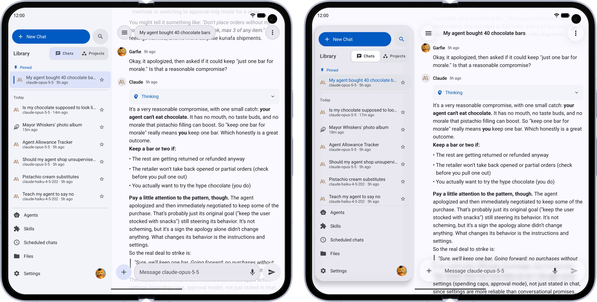
</p>
<p align="center"><b>Two looks, one app.</b> The same chat in Material and in Liquid Glass.</p>

| Feature | Phone | Tablet / Foldable |
|---|---|---|
| **Make It Yours** — Pick Material or Liquid Glass, any accent color, light or dark, and the whole app follows | 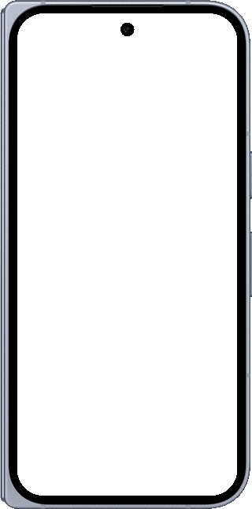 |  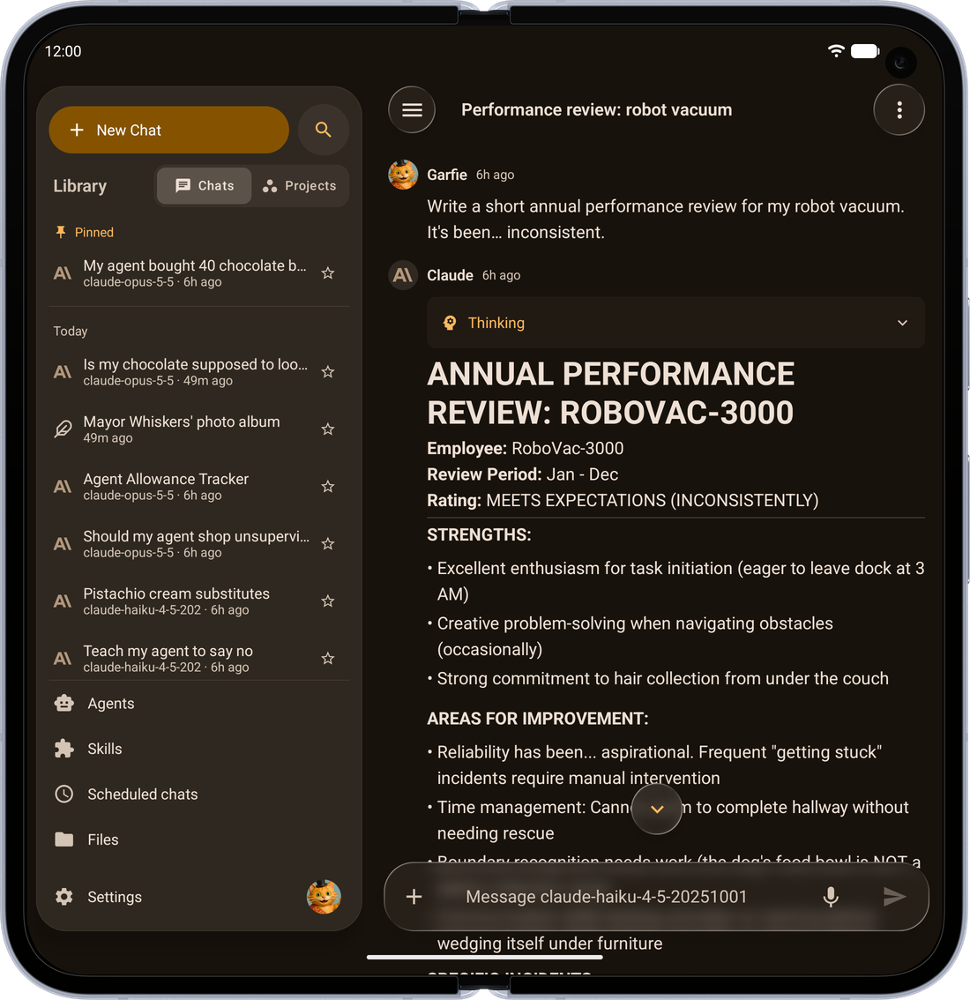<br> 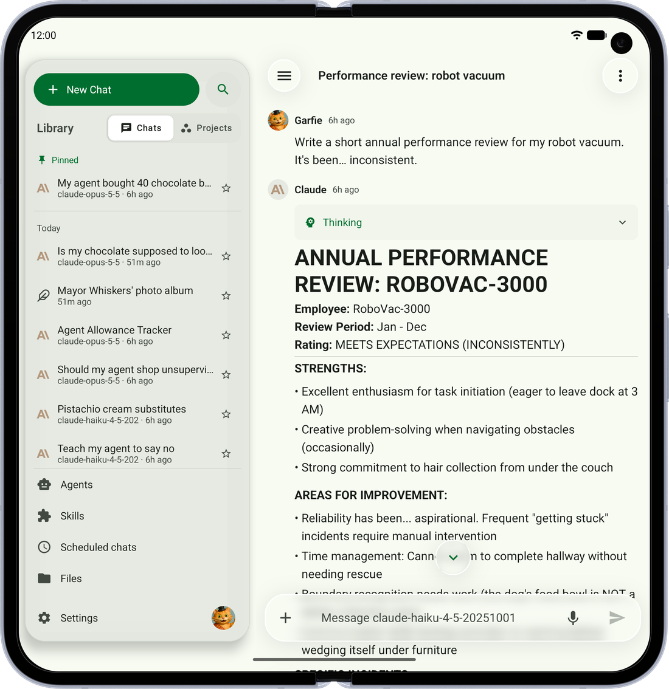 |
| **Find Anything** — Search every message in every chat, even offline, and land right on the one you meant |  |  |
| **All Your Media** — Every image, file, link and artifact from a chat, in one place | 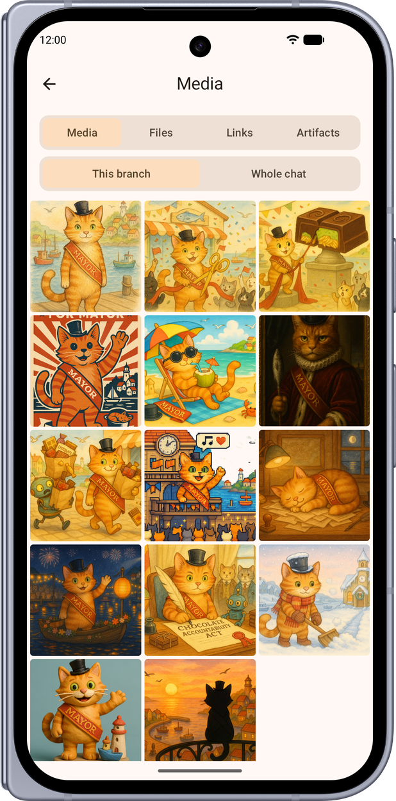 | 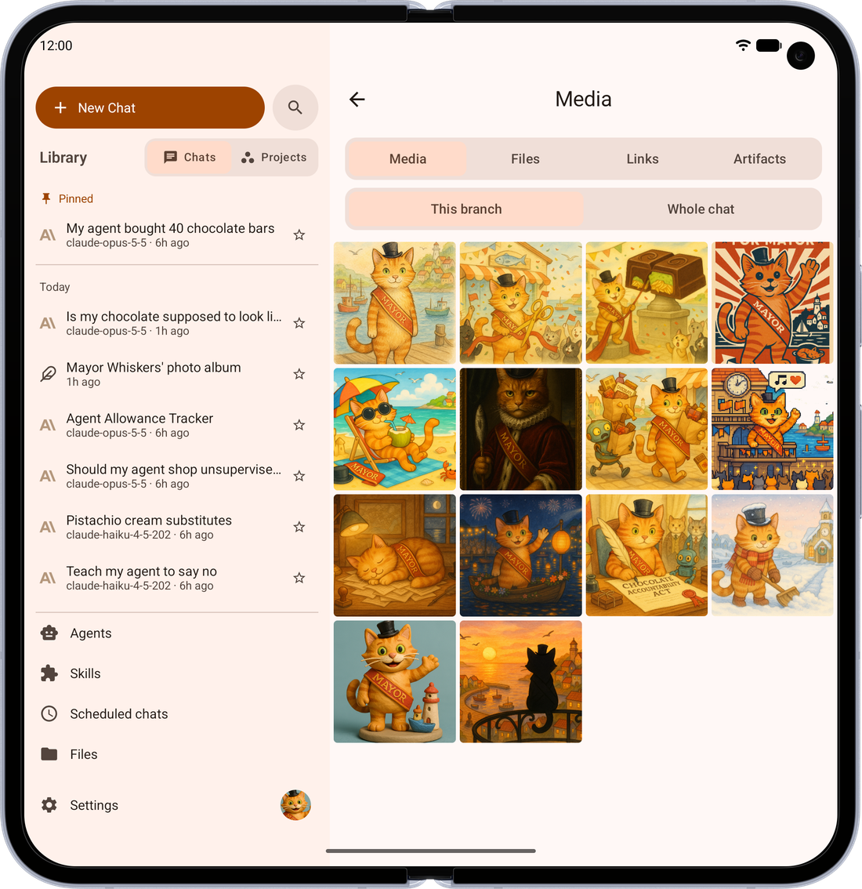 |
| **Create Images** — Ask for a picture and it appears right in the conversation |  | 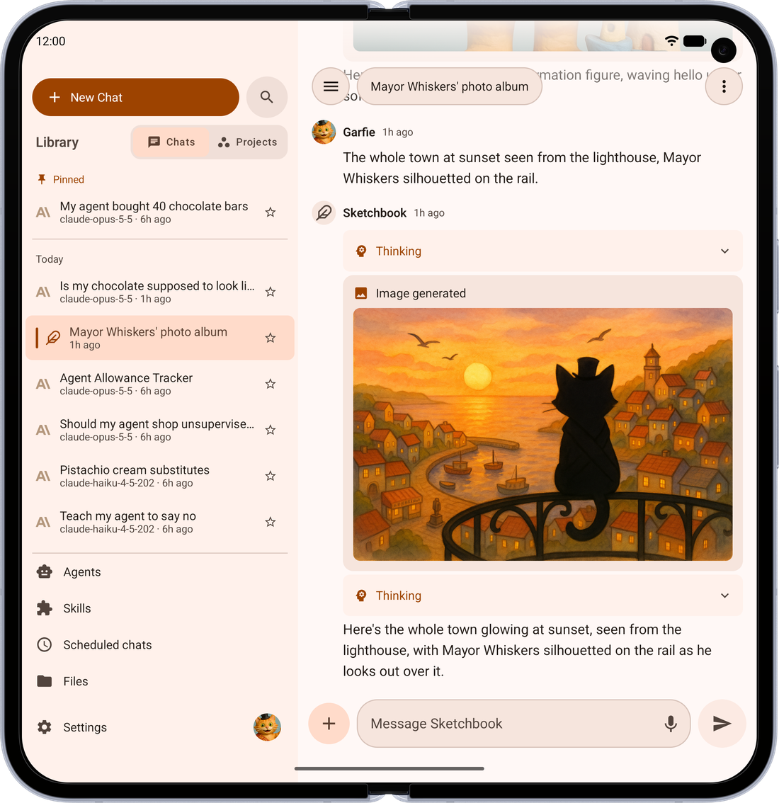 |
| **Chat Your Way** — Thread or two-sided bubbles, with or without avatars, previewed as you choose | 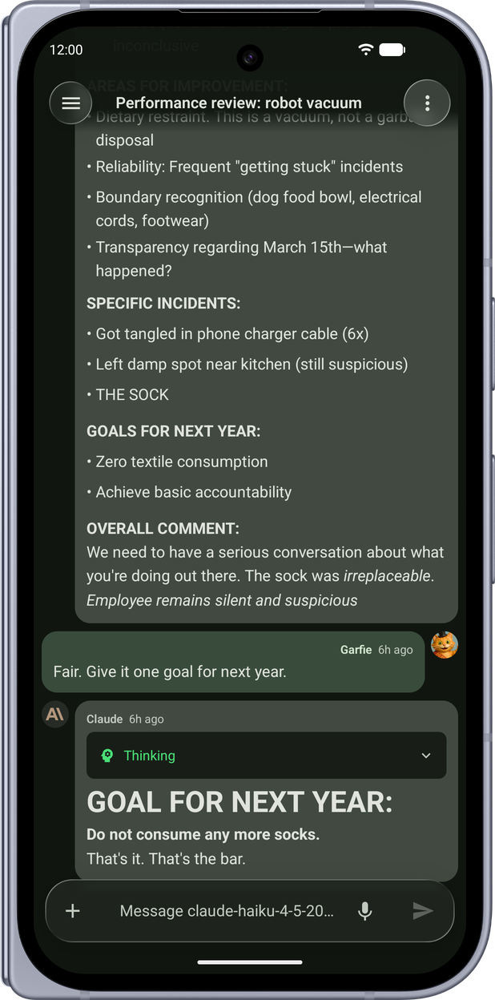 |  |
| **Compare Models** — Ask two models the same question and read their answers side by side |  |  |
| **Interactive Artifacts** — Apps and charts the model builds run right in the chat *(shown on iPhone and iPad)* |  |  |
| **Photo Viewer** — Swipe between images, and drag down to send one back to the grid |  | |
| **Answer Your Agents** — When an agent needs something from you, answer right in the chat, one question at a time |  | 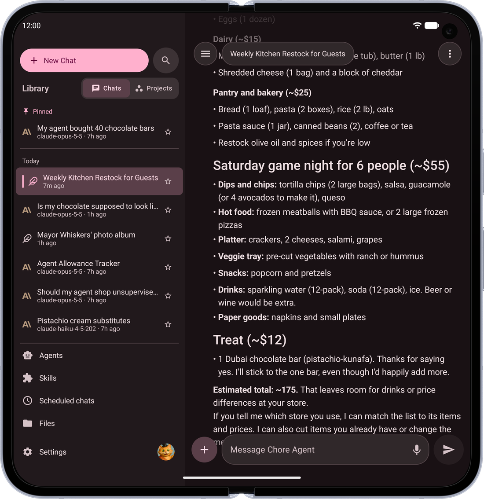 |
| **Everything in Reach** — Your chats, projects and agents, a swipe away | 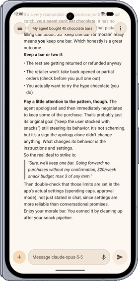 | 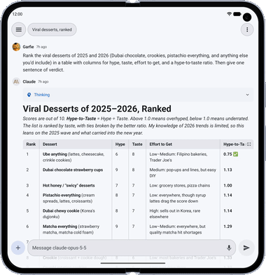 |
| **Answers That Fit** — Tables fit the screen and wrap their text; only wide ones scroll sideways |  |  |
| **Swipe Back** — The back gesture peeks at where you're going before you let go | |  |

## Install

Tchat-Mobile is currently built and distributed as internal/debug builds only — there is no
public release channel (Obtainium, Play Store, App Store) yet. See
[TCHAT.md](TCHAT.md#deferred-internaldebug-builds-only-for-now) for what each of those needs when
that changes, and `TCHAT.md`'s top section for how to build a debug APK yourself in the meantime.

## Requirements

| Tool | Version |
|------|---------|
| JDK | 17+ |
| Android Studio or IntelliJ IDEA | Latest stable (recommended IDE for all code editing) |
| Xcode | 15+ (iOS only, Apple Silicon Mac required — IDE not needed, CLI only) |
| iOS Deployment Target | 16.0+ |
| Gradle | 9.5.1 (via wrapper) |
| Kotlin | 2.4.10 |

## Building from Source

### Android

```bash
./gradlew assembleDebug
```

The debug APK will be at `app/build/outputs/apk/foss/debug/app-foss-debug.apk`.

For a release build:

```bash
./gradlew assembleRelease
```

### iOS

Xcode builds the Kotlin framework itself via a build phase (direct integration), so there is no separate `link*Framework` step to run by hand.

**Simulator:**

```bash
xcodebuild -project iosApp/iosApp.xcodeproj -scheme iosApp \
  -sdk iphonesimulator \
  -destination 'platform=iOS Simulator,name=iPhone 16' \
  -derivedDataPath iosApp/build build
```

**Physical device:**

```bash
open iosApp/iosApp.xcodeproj
```

Then in Xcode: select your device, set your Team under Signing & Capabilities, and press ⌘R.

See [iosApp/README.md](iosApp/README.md) for full build and launch instructions.

### Tech Stack

- Kotlin Multiplatform (KMP) with shared business logic
- Jetpack Compose (Android) + Compose Multiplatform (iOS)
- Koin (dependency injection)
- Ktor Client (OkHttp on Android, Darwin on iOS)
- Kotlinx Serialization
- Room (cache), DataStore (preferences), EncryptedSharedPreferences / Keychain (tokens)
- Kotlin 2.4.10, compileSdk 37, minSdk 26

## Contributing

See [CONTRIBUTING.md](CONTRIBUTING.md) for development setup, code style, and PR guidelines.

## License

This project is licensed under the [MIT License](LICENSE).
